# Driftwing

A calm, painterly bird-gliding game for the browser. Glide over an endless dreamy landscape,
through a neon-lit Japanese bay city or among misty karst peaks on a jade river, follow ribbons of glowing wisps and build a melody as you
gather them. No fail state, no timer, no enemies. Everything (terrain, trees, cities, sky,
music, sound) is generated procedurally: the repository contains no art or audio assets.

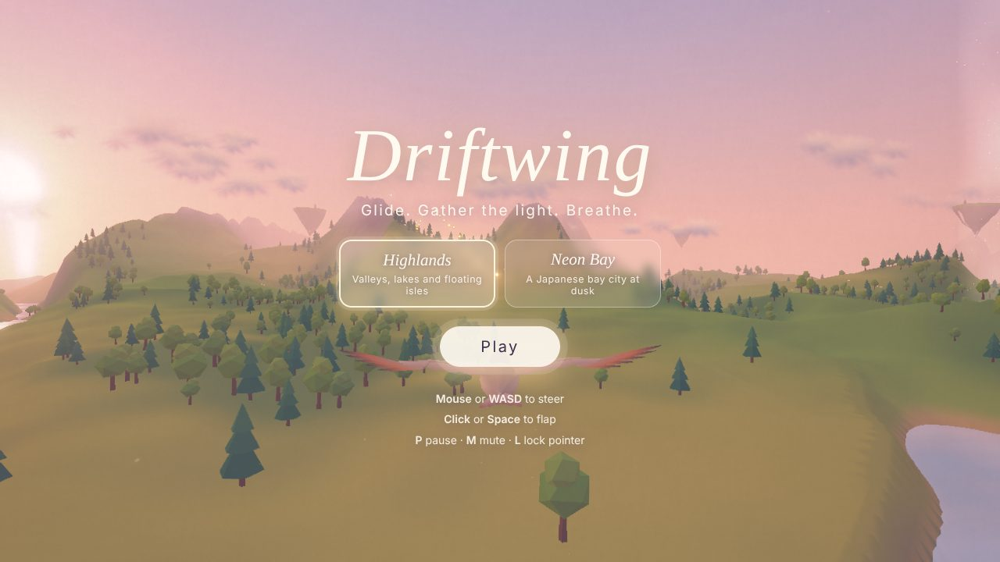

| Day                                | Golden hour                                 |
| ---------------------------------- | ------------------------------------------- |
| 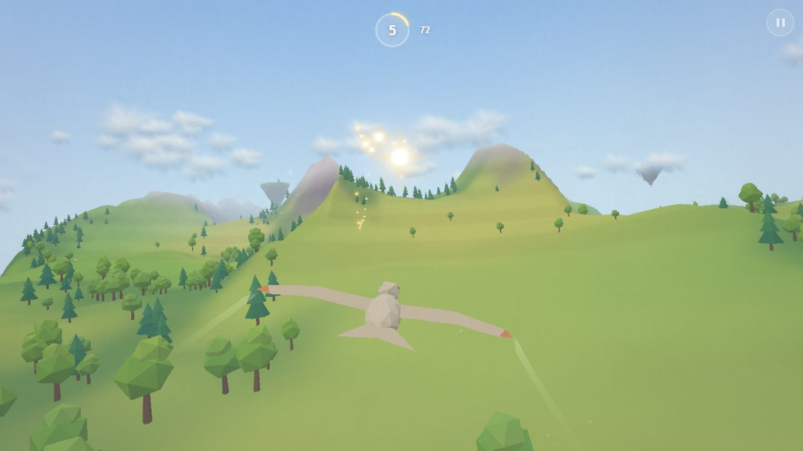   | 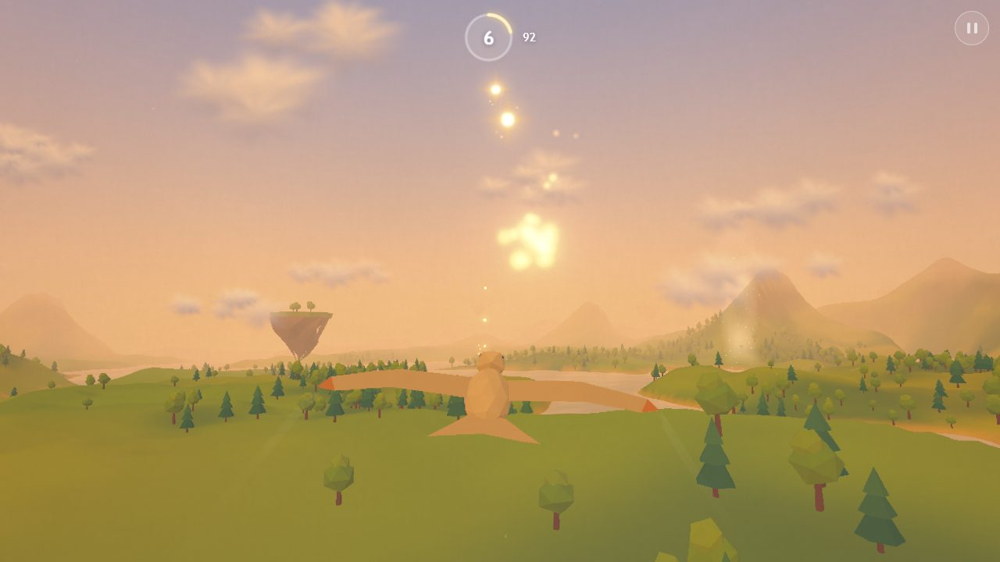 |
| **Dusk**                           | **Twilight**                                |
| 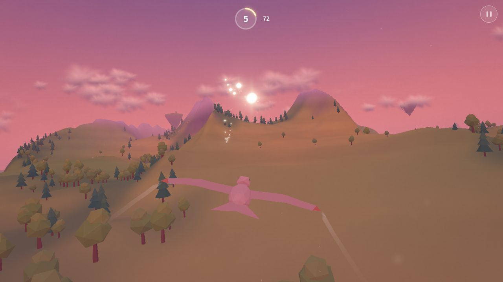 | 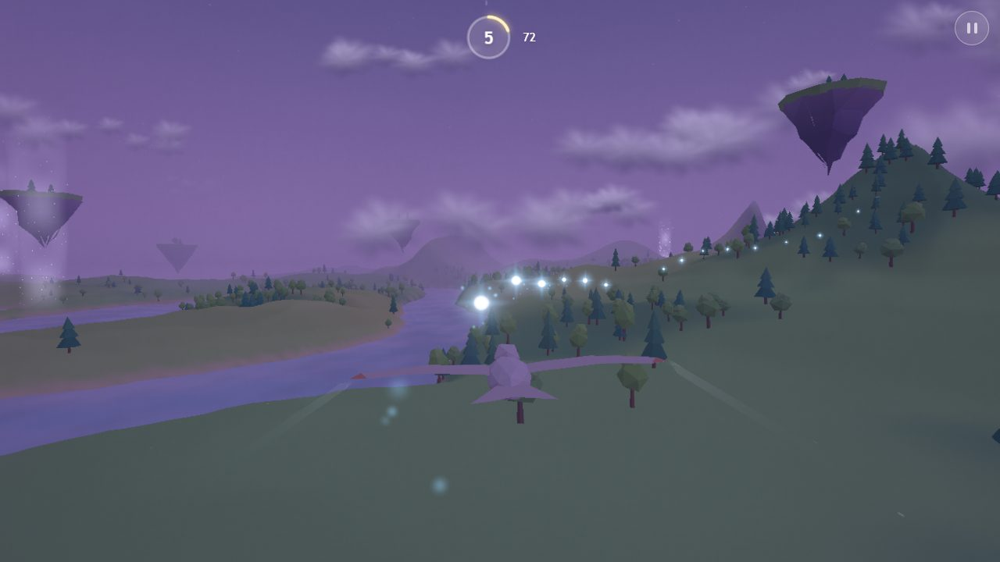  |

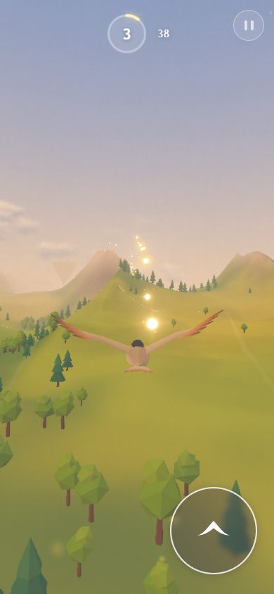

### Levels

Pick a level on the title screen (the live backdrop follows your pick; the pause menu can take
you back to choose again).

- **Highlands**: endless valleys, lakes, forests and floating islands.
- **Neon Bay**: an endless Japanese megacity on a bay, a Tokyo and Osaka blend, opening at dusk.
  Start out on the water, fly through a giant torii and up a boulevard into the skyline. Glass
  towers, narrow neon-signed shopping streets (busiest along the river), tiled-roof houses,
  shrines and temples with pagodas, cherry-tree parks, elevated expressways, a lattice
  broadcast tower and Fuji on the horizon. Windows and neon light up as night falls; the music
  turns to Japanese pentatonic scales. Wisps lead down the avenues at street-canyon height:
  buildings are solid but soft (you glance off them) and the bird veers around walls ahead.

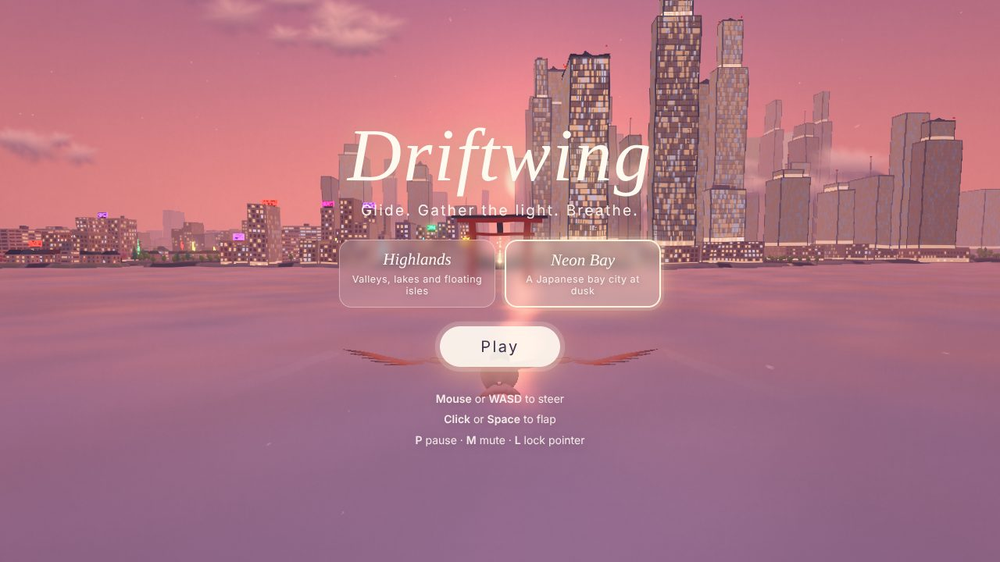

| Down the boulevard at dusk                          | Night                                     |
| --------------------------------------------------- | ----------------------------------------- |
| 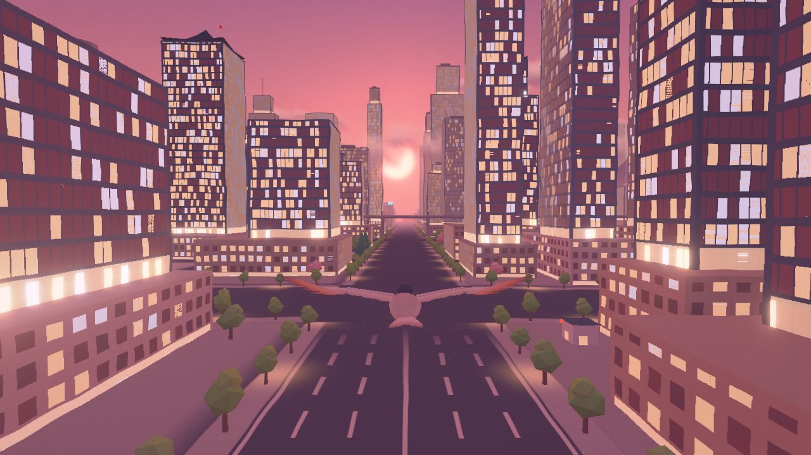         | 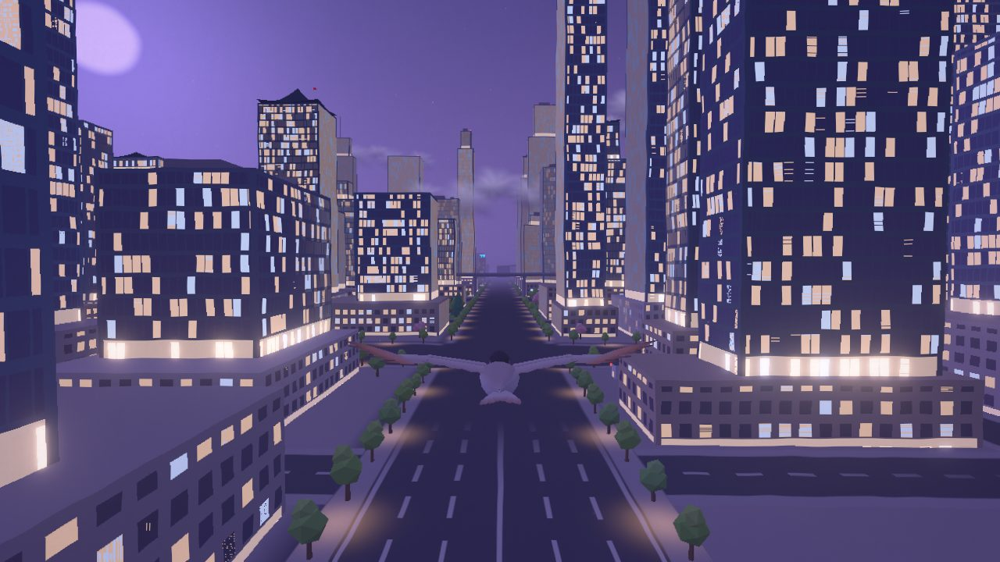 |
| **Temple and pagoda**                               | **Broadcast tower and Fuji**              |
| 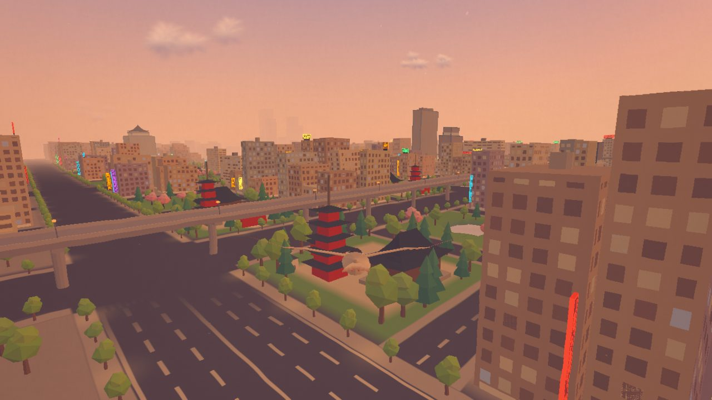         | 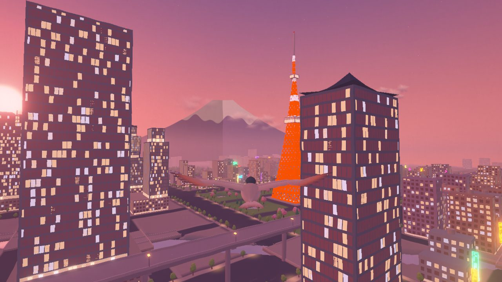 |
| **Under the expressway**                            |                                           |
| 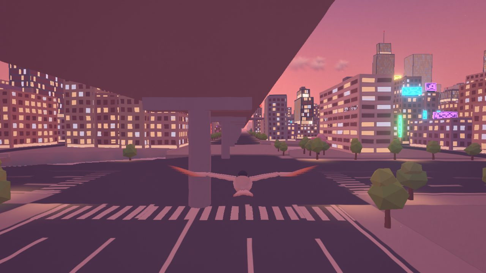 |                                           |

- **Jade River**: an endless valley of limestone pillars after the Li River at Guilin, opening
  at dawn. Morning mist pools between the peaks and burns off through the day; far peaks fade
  in layers like ink washes, and more are painted round the horizon. Rivers wind through
  terraced paddies (some flooded, mirroring the sky), bamboo-lined banks and whitewashed
  villages; cormorant fishers' rafts drift on the water and red pavilions crown a few summits.
  Lanterns glow after dark. The music walks the Chinese pentatonic modes. Wisps follow the
  river, weave between the pillars and now and then spiral up a peak and over its summit;
  pillars are solid but soft, like the city's walls.

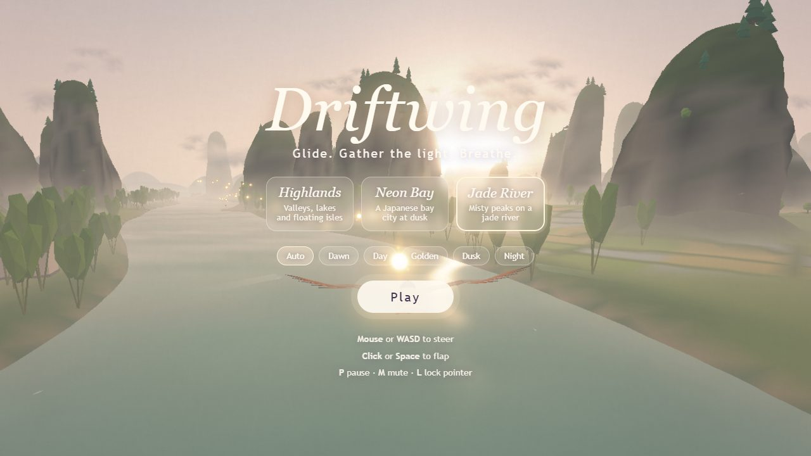

| Down the river at dawn                       | Above the morning mist                     |
| -------------------------------------------- | ------------------------------------------ |
| 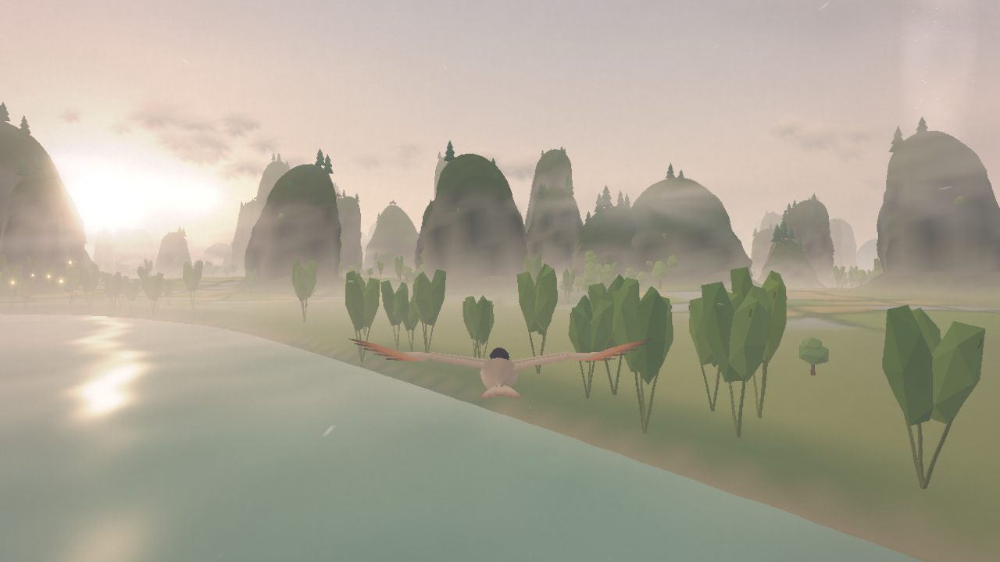   | 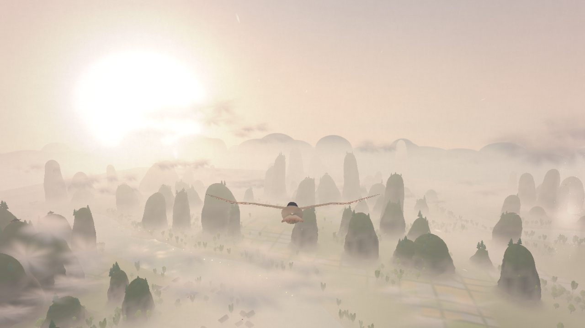   |
| **Golden hour**                              | **Night**                                  |
| 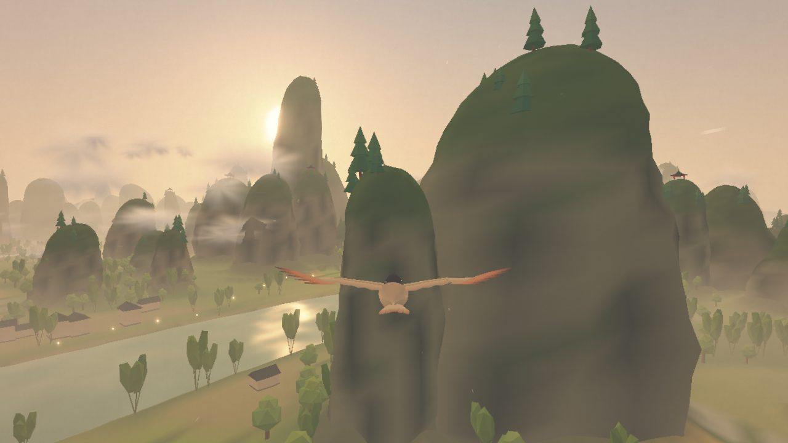 | 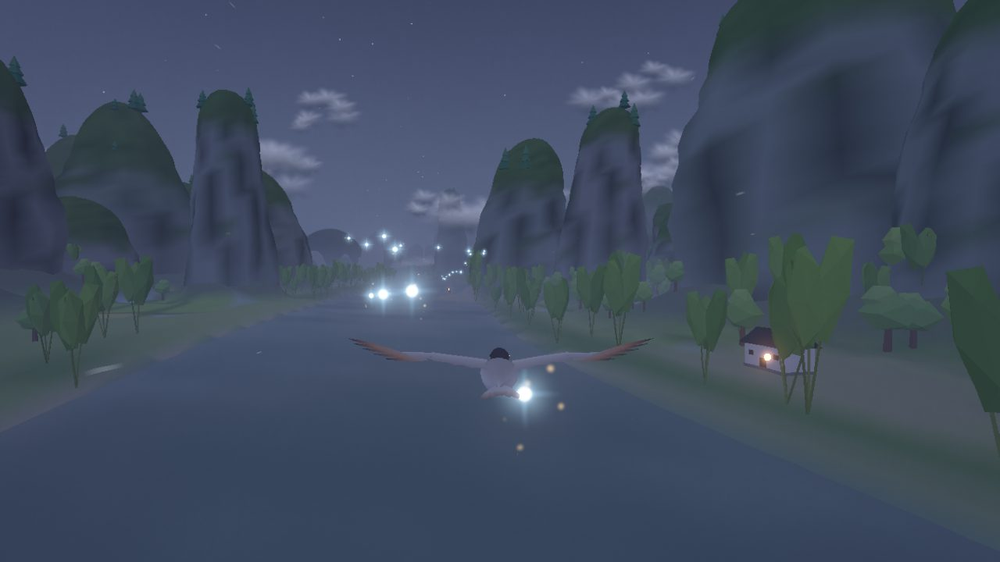 |

## Play

```bash
npm install
npm run dev        # http://localhost:5173
```

| Action       | Mouse / keyboard                             | Touch                                         | Gamepad    |
| ------------ | -------------------------------------------- | --------------------------------------------- | ---------- |
| Steer        | Pointer offset from centre, or WASD / arrows | Drag anywhere (relative to where you touched) | Left stick |
| Flap         | Click or hold Space                          | Hold the wing button, or tap a second finger  | A / RT     |
| Pause        | P or Esc                                     | Pause button (top right)                      | Start      |
| Mute         | M                                            | Pause menu                                    |            |
| Pointer lock | L (optional, relative mouse steering)        |                                               |            |

Fly through wisps to score. Quick chains fill the **flow** ring, which multiplies points (up to
5x) and brings extra layers into the music. Every 24 wisps a lantern ignites ahead of you and
the music modulates. Rising **thermals** (sparkling columns) lift you for free. Brushing the
ground or water is only ever a soft skim.

## Develop

| Command           | What it does                                                                                 |
| ----------------- | -------------------------------------------------------------------------------------------- |
| `npm run dev`     | Dev server. Add `?debug` for the lil-gui tuning panel (every value in `src/core/Config.ts`). |
| `npm run check`   | Typecheck, lint, unit tests and production build.                                            |
| `npm test`        | Vitest: flight model, noise determinism, flow/score, fixed-step loop, music scheduler.       |
| `npm run build`   | Static production build in `dist/` (relative paths, deployable anywhere).                    |
| `npm run preview` | Serve the production build.                                                                  |
| `npm run shots`   | Regenerate the README screenshots (needs a running dev or preview server).                   |

URL flags: `?debug`, `?autopilot` (a bot flies and collects, used for screenshots),
`?time=0..1` (time of day), `?seed=N` (world seed), `?quality=low|medium|high`,
`?level=highlands|city|karst`.

Screenshot scripts use Playwright's Chromium; set `CHROMIUM_PATH` to use another build.

Pushing to `main` deploys to GitHub Pages via `.github/workflows/pages.yml` (enable Pages with
"GitHub Actions" as the source in the repository settings).

## How it works

- **Flight**: an arcade glide model (`src/player/FlightModel.ts`) that trades height for speed,
  steers through critically damped springs and can't stall or crash, at a fixed 60 Hz step with
  interpolated rendering.
- **Levels**: a level supplies a `World` (`src/levels/`): terrain, scenery, what is solid, and
  hooks for where wisps and thermals go. Game and gameplay only talk to that interface, so the
  level can be swapped at runtime.
- **World**: seeded simplex noise drives one height function shared by terrain chunks (streamed,
  pooled, two LODs), instanced forests, wisp placement and collisions. A palette-driven day cycle
  tints sky, fog, light, water and the post grade.
- **City**: a pure, seeded layout (`src/world/city/CityLayout.ts`) of superblocks, blocks and
  avenues gives every building, shrine and tree as data, shared by the instanced renderer (a
  handful of meshes; window grids and neon are drawn by a facade shader, the street grid
  analytically on the ground), collisions and wisp planning, which checks every ribbon is clear.
- **Jade River**: another pure, seeded layout (`src/world/karst/KarstLayout.ts`): rivers on the
  zero contours of a noise, pillars lathed from one radius profile that the mesh and the
  collisions share, and a valley mist shader patched into the level's materials and the water.
- **Look**: soft toon banding, gentle bloom, a paper-grain/edge-wobble/grade/vignette pass.
- **Music**: a Web Audio lookahead scheduler plays detuned pads, a drone, FM bells and
  flow-driven layers in pentatonic keys that drift with the time of day. Each wisp plays the
  next note of a phrase, quantized to the beat.

See [`docs/DESIGN.md`](docs/DESIGN.md) for the design and the decisions log.
